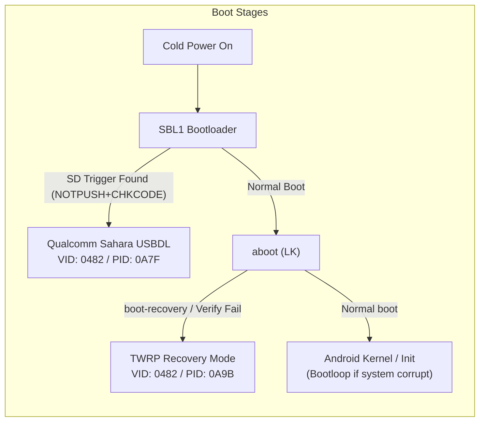
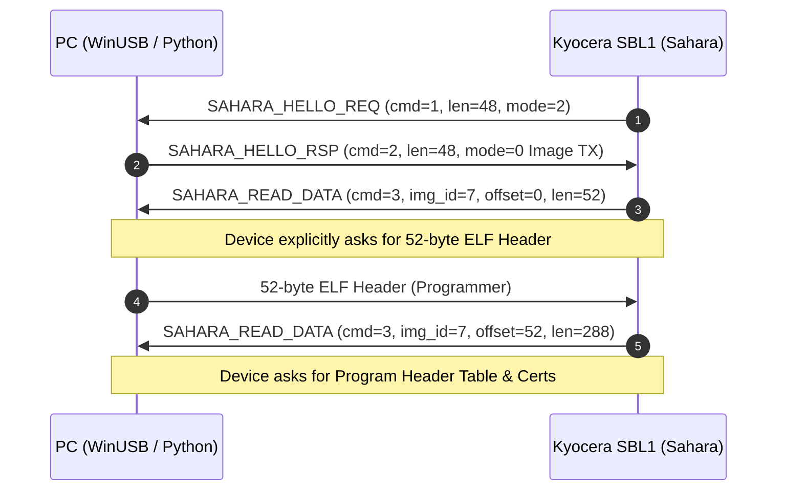
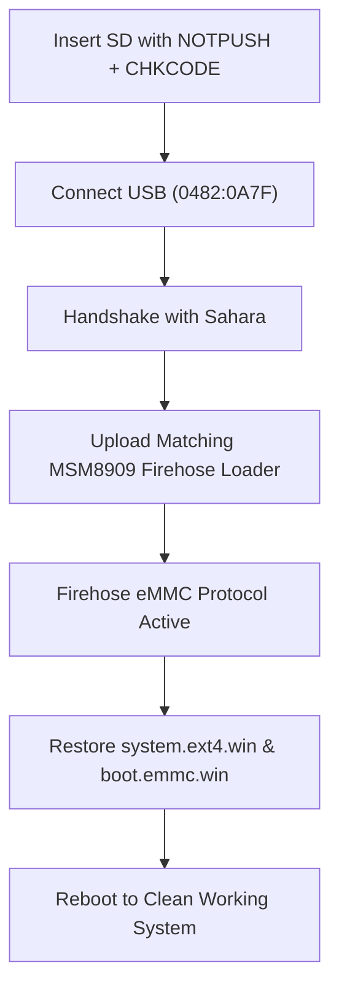

# Kyocera GRATINA KYF37: Architecture, Boot Chain & Recovery Discoveries

**Target Device:** Kyocera GRATINA KYF37 (au / KDDI, Japanese 4G LTE Feature Phone / Garaho)  
**Chipset:** Qualcomm Snapdragon 210 (MSM8909)  
**Analysis Date:** 2026-10-07  
**Operating System:** Android 5.1.1 (Kyocera Custom Build `104.0.2600`)  

---

## 1. Executive Summary

During the investigation into a persistent bootloop and recovery-mode lockout on the Kyocera GRATINA KYF37, deep reverse-engineering of the device's storage dumps, bootloader binaries (`sbl1`, `aboot`), and low-level USB communication protocols revealed the complete internal security and boot architecture. 

Key discoveries include:
1. **Physical Key Combinations Disabled:** Kyocera stripped all physical button-combination recovery detection from `aboot`. The phone cannot enter Recovery Mode (TWRP) via hardware buttons.
2. **MicroSD Bootloader Backdoor Verified:** SBL1 features a factory SD card parsing routine. When an SD card contains `NOTPUSH` and `CHKCODE` (both filled with `DEVKEYDL`), SBL1 halts the boot sequence before the kernel/system loop and drops into Qualcomm Sahara / USBDL mode (`VID_0482&PID_0A7F`).
3. **Bootloader Verification Fallback:** Disassembly of `aboot` revealed an automatic failover: if the `boot` partition signature fails verification against the OEM keystore, `aboot` automatically reboots directly into `recovery`.
4. **Qualcomm Test Keys Used:** The device's Secure Boot certificate hierarchy utilizes Qualcomm SecTools Test CA certificates (`Generated Test Root CA`) with `OEM_ID=0000` and `MODEL_ID=0000`.
5. **Existing TWRP & Stock Backups:** Full TWRP backups of all critical partitions (`boot`, `system`, `data`, `recovery`) exist locally on the host machine.

---

## 2. Hardware Identifiers & USB Enumeration



| State | USB VID / PID | Interface Name / Driver | Endpoints | Behavior |
| :--- | :--- | :--- | :--- | :--- |
| **Sahara USBDL Mode** | `0482:0A7F` | Android Bootloader Interface (`WinUSB`) | `0x01` (OUT), `0x81` (IN) | Screen completely black; device responds to Sahara packets. |
| **Diagnostic Mode** | `0482:0A9D` | Qualcomm HS-USB MDM Diagnostics | COM Port / Serial | Diagnostic command channel for NV and BlockDev access. |
| **ADB / TWRP Mode** | `0482:0A9B` | Android Composite ADB Interface | Bulk endpoints | Standard ADB daemon communication. |
| **Normal OS / CD-ROM** | `0482:0A8F` | Kyocera USB Driver / Mass Storage | Bulk / SCSI | Initial USB driver installation disk presentation. |

- **Chip Serial Number:** `0x126A2083` (`308945027`)
- **Sahara Version:** Version 2 / Mode 2 (`SAHARA_MODE_MEMORY_DEBUG`)

---

## 3. Storage Partition Table (GPT Breakdown)

Extracted from `/local/tmp/gpt-head.bin` found inside the device's backup files. The storage is an 8 GB eMMC with 512-byte sectors (`15,269,854` total sectors).

| Partition # | Name | Start Sector | End Sector | Size | Purpose |
| :---: | :--- | :--- | :--- | :--- | :--- |
| **1** | `modem` | 2,048 | 133,119 | 64.0 MB | Baseband firmware |
| **2** | `sbl1` | 133,120 | 135,167 | 1.0 MB | Qualcomm Secondary Bootloader 1 |
| **3** | `sbl1bak` | 135,168 | 137,215 | 1.0 MB | Backup SBL1 |
| **4** | `tz` | 137,216 | 139,263 | 1.0 MB | Qualcomm TrustZone |
| **6** | `rpm` | 141,312 | 142,335 | 512 KB | Resource & Power Management |
| **8** | `aboot` | 143,360 | 147,455 | 2.0 MB | Applications Bootloader (LK) |
| **10** | `boot` | 151,552 | 184,319 | 16.0 MB | Android Kernel + Ramdisk |
| **11** | `recovery` | 184,320 | 217,087 | 16.0 MB | **TWRP Recovery Partition** |
| **15** | `system` | 290,816 | 3,440,639 | 1.5 GB | Android OS System Image |
| **18** | `userdata` | 5,506,048 | 14,162,943 | 4.1 GB | User data & installed apps |
| **21** | `misc` | 15,022,080 | 15,024,127 | 1.0 MB | Bootloader Control Block (`BCB`) |
| **25** | `keystore` | 15,030,272 | 15,031,295 | 512 KB | OEM Public Keys for boot verification |
| **32** | `chkcode` | 15,149,056 | 15,151,103 | 1.0 MB | Factory test & Fastboot trigger flag |

---

## 4. Bootloader (`aboot`) Reverse Engineering

Binary analysis of `aboot.img` (Little Kernel VirtAddr `0x8F600000`) revealed critical behaviors:

### A. Why Physical Buttons Do Not Boot Recovery
Kyocera modified the LK codebase to eliminate standard Android key chords (e.g., `Power + Vol Down` or `Power + Manner Key`). 
- Scanning the binary for `twrp`, `recovery_keys`, or GPIO button checks confirmed **no key combinations trigger `boot-recovery` directly**.

### B. Boot Decision Logic & Failover
Disassembly of the boot validation routines in `aboot`:

```text
Authenticating boot image (%d): start
Authenticating boot image: done return value = %d
Device verification failed. Rebooting into recovery.
Recovery image verification failed. Asserting..
```

> [!IMPORTANT]
> **Key Finding:** If the `boot` partition signature does not validate against the OEM keys stored in the `keystore` partition, `aboot` does **not** hard-brick or halt; it automatically initiates a failover boot straight into `recovery`!

### C. Boot Control Block (`misc` Partition)
`aboot` inspects the first sector of partition 21 (`misc`):
- If it contains `boot-recovery`, the bootloader loads and executes the kernel in `recovery` (`mmcblk0p11`).
- This was how the device booted into TWRP at 5:26 AM earlier today.

### D. Fastboot Mode Magic (`chkcode`)
In `fastboot_standalone.py`:
- Writing `b"LOOTBFCK" + b"\xff" * 8` to partition 32 (`chkcode`) forces `aboot` to halt in **Fastboot Mode**.

---

## 5. Qualcomm Sahara & Protocol Handshake Analysis

When the phone boots with the MicroSD trigger, SBL1 intercepts execution and opens the Qualcomm Sahara interface over WinUSB endpoints `0x01` and `0x81`.



### Sahara Command Mode Capabilities
Sending `SAHARA_HELLO_RSP` with `mode = 3` placed the phone into **Sahara Command Mode** (`cmd = 0x0B` `SAHARA_CMD_READY`):
- `mcmd = 1` (`SERIAL_NUM_READ`): Successfully returned `0x126A2083`.
- `mcmd = 2` (`MSM_HW_ID_READ`): Restricted by SBL1 security policy.
- `mcmd = 3` (`OEM_PK_HASH_READ`): Restricted by SBL1 security policy.

---

## 6. Qualcomm Certificate & Secure Boot Analysis

Inspection of DER certificates embedded within `aboot.img` revealed the exact cryptographic identity of the device:

```
[Root CA]
  CN = Generated Test Root CA
  OU = CDMA Technologies, General Use Test Key (for testing only)
  SHA256 = dec46bfeaaa27d3b81d80def953821438192b95d493badc60e9f41f1edf6076f
  PKHash (SHA256 of SPKI) = 092447ed2ebb0a5370e314d7d0992061ffa1fffc8e823130b58efafb34867993
       │
       ▼
[Intermediate CA]
  CN = Generated Test Attestation CA
  O  = SecTools
  SHA256 = 4aefb95e3b585d12593d421c0203ca94896f8a8ce23ec8a2e6b114faef665219
       │
       ▼
[Attestation / Leaf Certificate]
  CN = SecTools Test User
  SW_ID = 0000000000000009 (aboot)
  HW_ID = 0000000000000000
  OEM_ID = 0000
  MODEL_ID = 0000
```

> [!NOTE]
> Kyocera did not fuse proprietary OEM root keys into the MSM8909 for this build; the platform uses **Qualcomm Reference Test Keys** (`OEM_ID=0000`, `MODEL_ID=0000`).

---

## 7. MicroSD Hardware Override (Trigger Files)

On Qualcomm-based Kyocera rugged and flip devices, `sbl1` implements an SD card recovery routine (`SD DL`):

- **SD Format:** FAT32 partition (preferably 4 GB or smaller).
- **Trigger Files in Root Directory:**
  1. `NOTPUSH`
  2. `CHKCODE`
- **File Contents:** The exact ASCII string:
  ```text
  DEVKEYDL
  ```
  *(Strictly 8 bytes, no trailing newline, carriage return, or spaces).*

### Observed Effects:
* **Bootloop Break:** Immediately prevents the device from cycling through the damaged Android system.
* **Sahara Enumeration:** Puts the SoC into Qualcomm Download Mode (`0482:0A7F`) with the screen off.

---

## 8. TWRP Status & Available Local Backups

The host machine holds complete, verified backups created by the user:

* **Location:** `C:\Users\pablo\Downloads\kyocera rom\TWRP\BACKUPS\981108631314\kyf37-pre-lineage-20261007\`
* **Timestamp:** `2026-10-07 05:26 AM` - `05:29 AM`
* **Contents:**
  - `boot.emmc.win` (16 MB, valid boot kernel + ramdisk)
  - `system.ext4.win` (974 MB, clean stock `/system` ext4 filesystem)
  - `data.ext4.win` (860 MB, stock user data and setup)
  - `recovery.log` (Complete TWRP execution log)
* **Pre-existing Backup:** `C:\Users\pablo\Downloads\kyocera rom\TWRP\BACKUPS\981108631314\2026-10-06--16-00-43_10402600\`
  - Contains `recovery.emmc.win` (TWRP 3.7.0 image signed for KYF37).

---

## 9. Recovery Action Plan



1. **Hardware Stabilization:** Device held in Sahara mode using the MicroSD `DEVKEYDL` triggers.
2. **Programmer Handshake:** Stream the test-key MSM8909 Firehose loader via `edl.py`.
3. **Partition Restoration:** Write stock `boot` and `system` back to eMMC partitions 10 and 15.
4. **Reboot:** Device boots cleanly into the original stock firmware.
